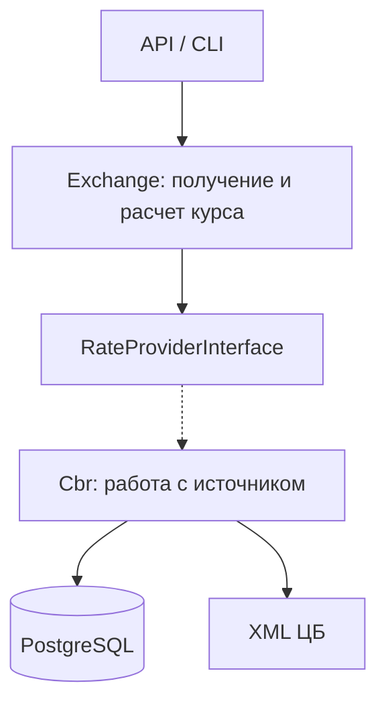
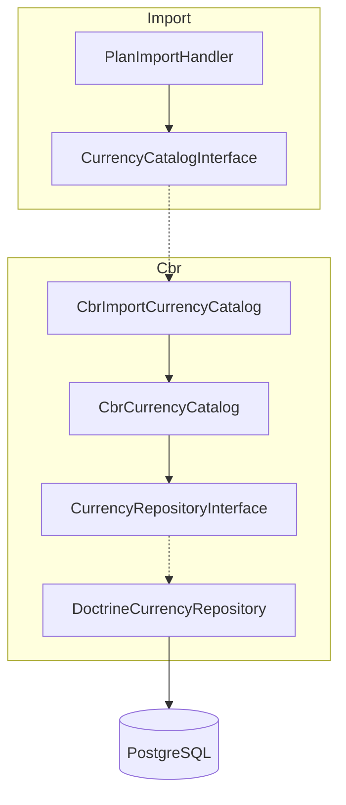
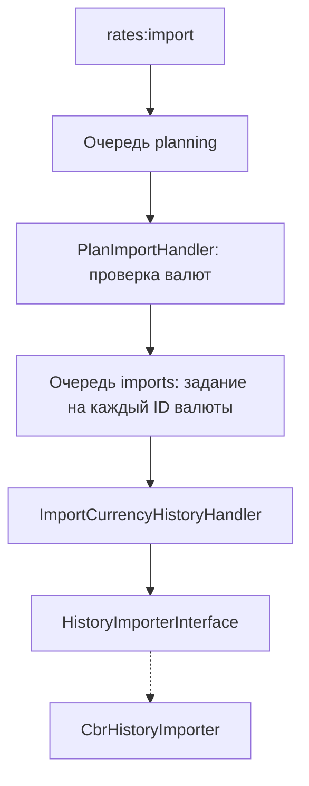
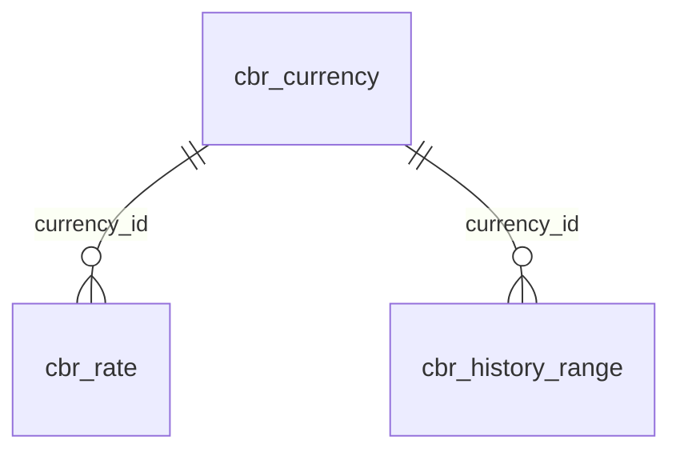

# Архитектура

## Общая схема

Стрелки показывают вызовы, пунктир - подключение реализации интерфейса через DI

- `Exchange` содержит общие модели, расчеты и контракт источника
- `Import` организует фоновую загрузку через сообщения и собственные контракты
- `Cbr` реализует эти контракты, работает с XML и хранит данные ЦБ

Зависимости кода направлены из `Cbr` в `Exchange` и `Import`, обратных зависимостей нет. Реализации подключаются в [
`config/services.yaml`](../config/services.yaml)

## Где находятся интерфейсы

На примере справочника валют:

`CurrencyCatalogInterface` описывает доступные для импорта валюты и принадлежит `Import`

`CurrencyRepositoryInterface` описывает хранение справочника ЦБ и остается внутри `Cbr`. Аналогично
`RateRepositoryInterface` отвечает за котировки и подтвержденные периоды

Общие модели `CalendarDate`, `CurrencyCode`, `Quote` находятся в `Exchange`. Их использование внутри `Cbr` допустимо,
они не содержат формата XML или структуры таблиц ЦБ

## Фоновая загрузка

`CbrHistoryImporter` загружает историю через `CbrClient` и сохраняет ее через `RateRepositoryInterface`. Без `--force`
полностью подтвержденный период пропускается

Временные ошибки повторяет Messenger, после исчерпания попыток сообщение попадает в `failed`

## Хранение

- `cbr_currency` - справочник, ключом служит ID ЦБ, ISO-код не уникален
- `cbr_rate` - значение и номинал, уникальная пара валюты и даты действия
- `cbr_history_range` - проверенные периоды по валюте, включая дни без новых котировок

Котировки и подтвержденный период сохраняются одной транзакцией, соседние и пересекающиеся диапазоны объединяются. Связи
диапазона с конкретной котировкой нет

При запросе используется точная котировка либо более ранняя с подтвержденным периодом до нужной даты. Если данных
недостаточно, провайдер загружает историю за неделю, при отсутствии котировки - за 180 дней

Кросс-курсы рассчитывает `CrossRateCalculator`, отдельно они не сохраняются

### Зачем нужен cbr_history_range

Одних котировок недостаточно для кеширования выходных и праздников. Отсутствие записи на дату может означать как
отсутствие нового курса у ЦБ, так и то, что приложение еще не загружало этот день. Например, в БД есть котировка USD за
пятницу, а запрос пришел на воскресенье. Вернуть пятничный курс без проверки нельзя - история за выходные могла еще не
загружаться. Но если сохранять только котировки, после успешной проверки воскресная запись так и не появится, и
следующий запрос снова пойдет в ЦБ.

`CbrHistoryRange` сохраняет факт успешной проверки диапазона по ID валюты ЦБ. Если диапазон покрывает промежуток от
пятничной котировки до воскресенья, приложение знает, что новых котировок за это время нет, и использует сохраненный
курс без повторного обращения к источнику

Диапазоны заполняются и при обычном запросе, и фоновым воркером. Успешный пустой ответ тоже подтверждает период, ошибка
загрузки - нет. Запись диапазона не создает искусственные котировки на каждый выходной и не хранит ссылку на пятничную
котировку
